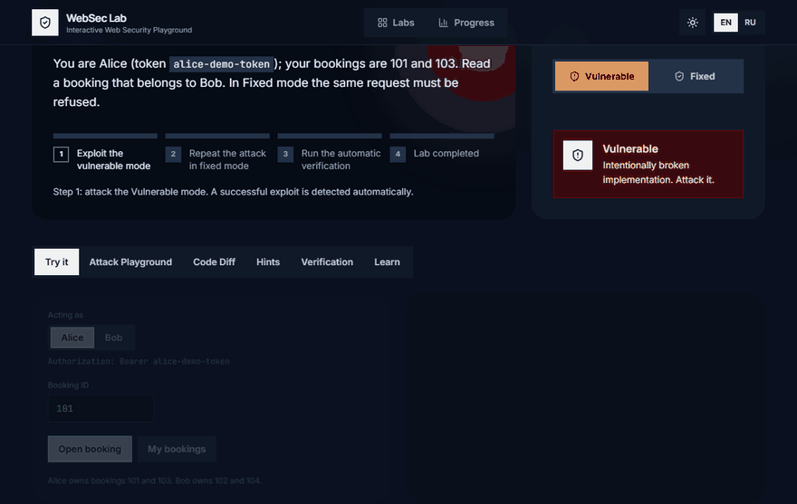
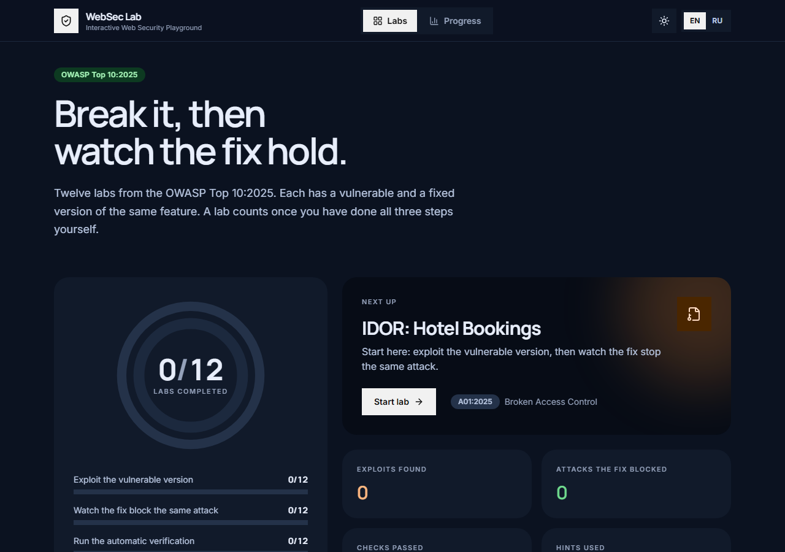
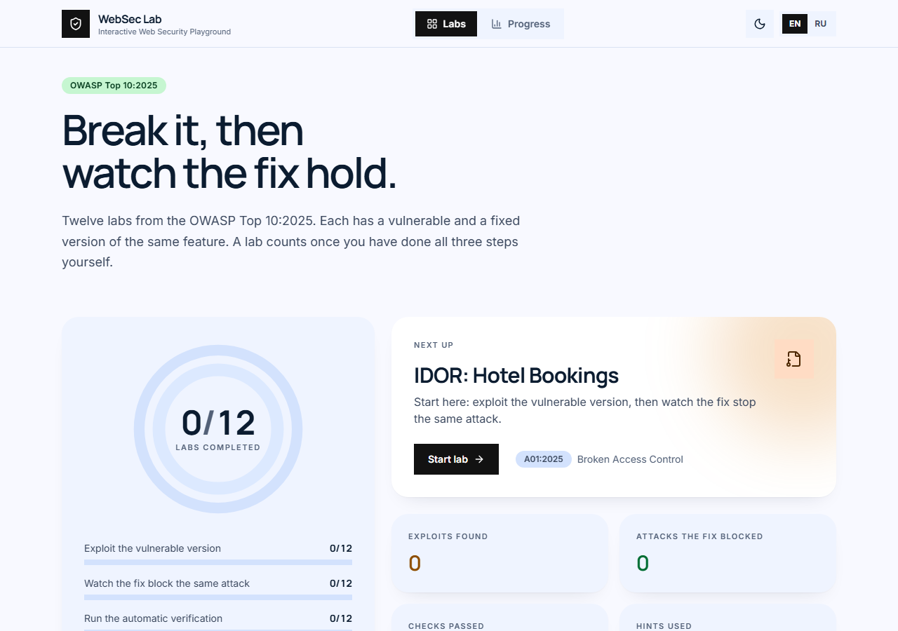
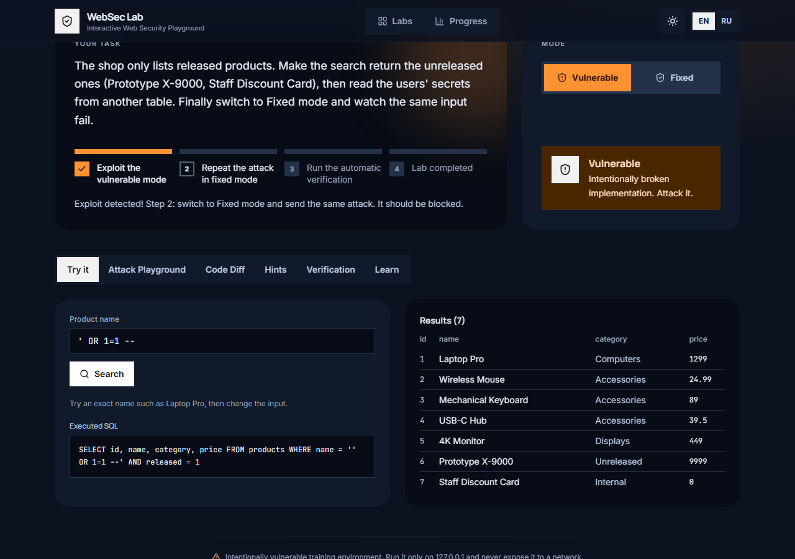
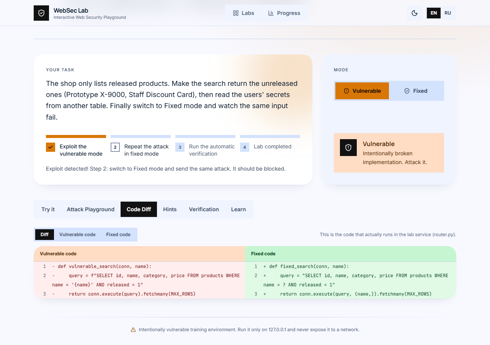

# WebSec Lab: Interactive Web Security Playground

[](https://github.com/TroubieD3v/WebSec-Lab/actions/workflows/ci.yml)
[](LICENSE)


**English** · [Русский](README.ru.md)

WebSec Lab is a local, open-source platform for learning web security by **breaking and fixing real code**.
Every lab ships an intentionally vulnerable implementation, the same feature with the fix applied, an API
playground, a side-by-side code diff, hints, and automated checks that *prove* the vulnerability exists and the
fix works. It is inspired by OWASP Juice Shop and WebGoat, with the emphasis on code comparison, API testing and
automatic verification.

The interface is dark by default with a light theme one click away (the sun/moon button in the header), and
available in English and Russian.

> **Warning**: the `labs` service is vulnerable on purpose. Run it only on `127.0.0.1` and never expose it to a
> network. See [SECURITY.md](SECURITY.md) and the [threat model](docs/threat-model.md).



*Alice reads Bob's booking in the vulnerable mode; in the fixed mode the same request is refused and the lab
records that you saw the fix hold.*

| Dashboard, dark theme (default) | Dashboard, light theme |
|---|---|
|  |  |

| Exploit detected automatically | Vulnerable vs. fixed code |
|---|---|
|  |  |

## Labs

Twelve labs covering five categories of the [OWASP Top 10:2025](https://top10.owasp.org/2025/).

| Lab | Demonstrates | OWASP Top 10:2025 | Difficulty |
|---|---|---|---|
| SQL Injection | String-built SQL vs. parameterized queries | A05 Injection | Easy |
| Reflected XSS | Unescaped reflection vs. output encoding + CSP, executed in a sandboxed iframe | A05 Injection | Easy |
| Stored XSS | A persisted payload that fires for every visitor vs. encoding on output + CSP | A05 Injection | Medium |
| IDOR | Reading other users' bookings vs. an ownership check | A01 Broken Access Control | Easy |
| Broken Access Control | Admin API reachable by users, privilege escalation by mass assignment vs. role checks and field allow-lists | A01 Broken Access Control | Medium |
| CSRF | A forged cross-site transfer vs. anti-CSRF token + `Origin` / `Sec-Fetch-Site` checks | A01 Broken Access Control | Medium |
| Path Traversal | `../` and absolute paths escaping a folder vs. a resolved-root check (simulated in-memory file system) | A01 Broken Access Control | Medium |
| Security Misconfiguration | Debug endpoint with secrets, stack traces, missing headers vs. a hardened configuration | A02 Security Misconfiguration | Easy |
| File Upload | HTML/SVG served as active content vs. allow-list, magic bytes, random names, hardened headers | A06 Insecure Design | Medium |
| Race Condition | A single-use coupon redeemed many times by parallel requests vs. an atomic check-and-claim | A06 Insecure Design | Hard |
| Broken Authentication | No lockout, user enumeration, predictable tokens, no-op logout vs. a hardened flow | A07 Authentication Failures | Medium |
| JWT Misconfiguration | `alg: none`, a guessable secret and ignored expiry vs. a pinned algorithm and validated claims | A07 Authentication Failures | Hard |

Each lab provides:

1. **Vulnerable mode**: the deliberately broken feature.
2. **Fixed mode**: the same feature with the fix.
3. **Attack Playground**: raw HTTP requests against the lab API, with presets and "copy as curl".
4. **Code Diff**: vulnerable vs. fixed source, taken from the code that actually runs.
5. **Hints**: three progressive hints, tracked in your progress.
6. **Automatic Verification**: reference attacks against both modes.
   A lab completes only after **you** (1) exploit the vulnerable mode, (2) send the same attack to the fixed mode and
   watch it get blocked, and (3) run the verification. Each step is detected by the server, not ticked by hand.
7. **Progress tracking**: status per lab, achievements, activity history.

The interface is available in **English and Russian** (switch in the header).

## Quick start (Docker)

Requires Docker with Compose v2.

```bash
git clone https://github.com/TroubieD3v/WebSec-Lab.git
cd WebSec-Lab
docker compose up --build
```

Open <http://127.0.0.1:3000>. Ports `3000` (dashboard) and `8081` (isolated lab origin used by the sandboxed
previews) are bound to the loopback interface only. Progress is kept in the `progress` Docker volume;
`docker compose down --volumes` deletes it.

**Troubleshooting**

- *Port 3000 already in use*: pick another dashboard port, e.g. `DASHBOARD_PORT=3100 docker compose up --build`
  (PowerShell: `$env:DASHBOARD_PORT=3100; docker compose up --build`), then open that port.
- *Port 8081 already in use*: stop whatever uses it, or change it in `compose.yaml` **and** in `frame-src` / `img-src`
  of `frontend/nginx.conf` (the sandboxed previews load from that port).
- *Open it as `127.0.0.1` or `localhost`*: other host names are blocked by the dashboard's CSP.
- *"Lab service is not reachable"* on the dashboard: `docker compose ps` should show all three services healthy.

## Local development (no Docker)

Three processes; run each in its own terminal from the repository root.

```bash
# 1. Vulnerable labs service (port 8081)
python -m venv .venv && . .venv/bin/activate          # Windows: .venv\Scripts\activate
pip install -r backend/requirements-dev.txt -r labs/requirements.txt
cd labs && uvicorn main:app --host 127.0.0.1 --port 8081

# 2. Control-plane API (port 8000)
cd backend && uvicorn app.main:create_app --factory --host 127.0.0.1 --port 8000

# 3. Dashboard (port 3000, proxies /api to :8000)
cd frontend && npm install && npm run dev
```

## Tests

```bash
ruff check && pytest                    # lint + 196 tests: lab behaviour (tests/security) and control plane (backend/tests)
cd frontend && npm run lint && npm run typecheck
cd tests/e2e && npm install && npx playwright install chromium
npx playwright test                     # 50 browser tests against a running stack, including a WCAG 2.1 AA audit
```

Python dependencies are pinned: edit the ranges in `requirements*.in`, then regenerate the pinned `requirements*.txt`
with `pip-compile` (pip-tools). Dependabot proposes weekly updates.

`tests/security` proves, for every lab, that the vulnerable mode is exploitable, that the fixed mode blocks the same
input, and that normal use still works. `tests/e2e` drives a real browser, including executing XSS inside the
sandboxed iframe and checking that it cannot reach the dashboard. The same reference attacks power the in-app
**Automatic Verification**. CI runs all of it, including the end-to-end tests against the Docker Compose stack.

## Architecture

```
Browser ──► nginx (:3000 dashboard)  ──/api──►  backend (FastAPI)  ──►  labs (FastAPI, vulnerable)
        └─► nginx (:8081 lab origin: XSS pages and uploads, iframe only) ────────┘
```

- `frontend/`: React + TypeScript + Vite + Tailwind CSS.
- `backend/`: control plane: catalog, hints, progress (SQLite), verification, code diff, hardened proxy. It never
  contains vulnerable code.
- `labs/`: only intentionally vulnerable scenarios and their fixes, in an isolated container.
- `tests/`: `security/` (pytest) and `e2e/` (Playwright). `docs/`: architecture and threat model.

Details: [docs/architecture.md](docs/architecture.md) · [docs/threat-model.md](docs/threat-model.md) ·
[CONTRIBUTING.md](CONTRIBUTING.md) · [CHANGELOG.md](CHANGELOG.md).

## Releases

| Version | Result |
|---|---|
| v0.1.0 | Interface, Docker, SQL Injection lab |
| v0.2.0 | XSS, IDOR, Authentication labs |
| v0.3.0 | Code Diff, hints, progress tracking |
| v0.4.0 | Full automated test suite and CI |
| v0.5.0 | Stored XSS, Broken Access Control, Path Traversal, Security Misconfiguration |
| v1.0.0 | All twelve labs, documentation, hardened Docker setup |
| v1.0.1 | Fixed dead reference links; link checker |
| v1.0.2 | Configurable dashboard port; Docker stack verified end to end |
| v1.1.0 | A lab now requires watching the fix block your own attack; mobile layout fixes |
| v1.2.0 | Minimal dark design with mode-driven colour and motion |
| **v1.2.1** | **WCAG 2.1 AA, linting, pinned dependencies, Dependabot** |

## License

[MIT](LICENSE)
