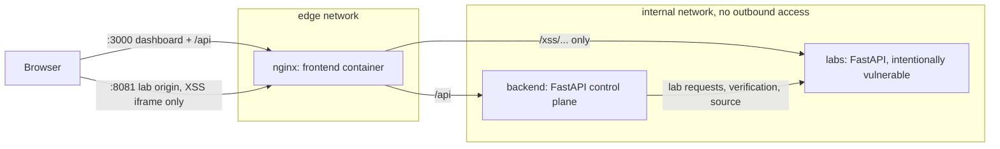

# Architecture

## Components

| Component | Responsibility | Must never |
|---|---|---|
| `frontend/` | Dashboard UI (React, TypeScript, Vite, Tailwind), i18n EN/RU, lab widgets, Playground, Code Diff | Render lab HTML on the dashboard origin |
| `backend/` | Catalog and teaching content, hints, progress (SQLite), automatic verification, code diff, hardened proxy | Contain vulnerable code or trust lab responses |
| `labs/` | Vulnerable scenarios and their fixes, challenge detection, source regions | Be reachable from outside the machine |

## Request flows

**Playground / widgets.** `fetch('/api/labs/<lab>/<mode>/<path>')` → backend proxy → `labs:/<lab>/<mode>/<path>`.
The proxy allows only known labs and the two modes, rejects path tricks, forwards three request headers, drops
cookies, caps body sizes, and returns HTML as `text/plain` inside a `Content-Security-Policy: sandbox`.

**XSS preview.** The dashboard embeds `http://<host>:8081/xss/<mode>/search?q=...` in
`<iframe sandbox="allow-scripts">` (no `allow-same-origin`). `lab.js` replaces `alert()` with a `postMessage` to the
parent plus a beacon request; the dashboard accepts messages only from that iframe's window.

**Challenge detection.** Two flags per lab, both set by the lab service from the learner's own requests.
`mark_solved(lab)` is called by a vulnerable endpoint when an attack succeeds. `mark_blocked(lab)` is called by a
fixed endpoint when the *same kind of attack* reaches it and is refused (a 403 for someone else's booking, a 415 for a
disguised upload, markup rendered as text, a parallel burst where only one request wins); ordinary use of the fixed
mode does not set it. In detail, `mark_solved(lab)` is set when a request actually crosses the security
boundary (e.g. a booking owned by someone else is returned). The backend polls `GET /<lab>/status` and persists the
first detection. Requests carrying the verifier header never count, and the proxy strips that header from user input,
so only the learner's own exploit completes a lab.

**Automatic verification.** `POST /api/labs/<id>/verify` runs the reference attacks in
`backend/app/services/verification.py` against both modes. Every check is one of:

- `functional`: normal use works (both modes);
- `attack`: the attack must succeed in vulnerable mode;
- `defense`: the same attack must fail in fixed mode.

A lab is **completed** when the vulnerability and fix are confirmed *and* the learner both exploited the vulnerable
mode and saw the fixed mode block that attack. The order does not matter. Databases from v1.0.x are migrated by adding
`defended_at` and withdrawing completions recorded under the old, weaker rule.

**Code Diff.** Lab source files mark the code that is shown with `# region vulnerable` / `# region fixed`.
`GET /<lab>/source` extracts those regions at runtime, so the diff is always the code that really runs.

## Data

Progress lives in the backend's SQLite database (`PROGRESS_DB`, a Docker volume): per-lab timestamps, hint reveals
and an event log. Lab state (sessions, rate-limit counters, challenge flags) is in memory and cleared by
`POST /reset-all` or a restart.

## Adding a lab

1. `labs/<package>/router.py`: define `LAB_ID`, `SOURCE_FILE`, `router`, `reset()`, and the code between
   `# region vulnerable` / `# region fixed`. Call `mark_solved` (attack succeeded, vulnerable mode) and `mark_blocked` (same attack refused, fixed mode) from
   the endpoint glue (outside the regions) when the
   attack succeeds. Register it in `labs/main.py`.
2. `backend/app/content/<lab>.py`: a `LabDefinition` with EN and RU text, three hints, presets and references; add it
   to `build_catalog()` (and remove the planned placeholder).
3. `backend/app/services/verification.py`: a verifier that records `functional`/`attack` checks for both modes, and
   register it in `VERIFIERS`.
4. `frontend/src/labs/<Lab>Demo.tsx` and an entry in `frontend/src/labs/index.ts`.
5. Tests in `tests/security/` and `tests/e2e/specs/`.
